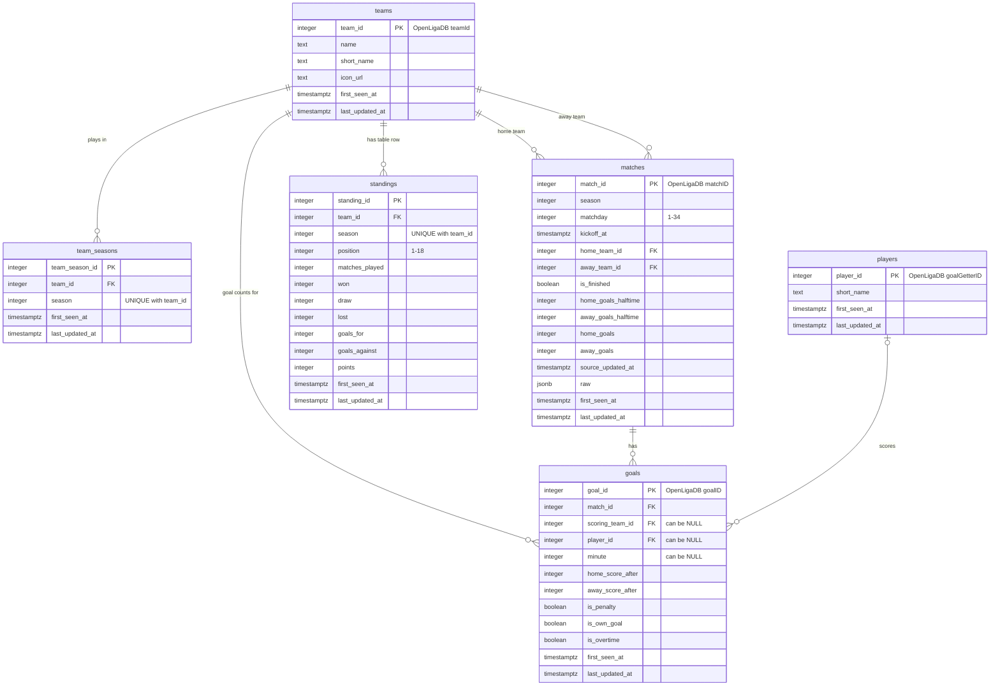

# Database Schema (Week 2)

The database holds my own copy of the OpenLigaDB Bundesliga data (seasons 2025 and 2026).
The tables are created by `db/schema.sql` and filled by `ingest/load.py`.

## ER diagram

## What one row means

- **teams:** One row is one Bundesliga club, with its OpenLigaDB team ID, name, and logo. A club has the same row in every season.
- **team_seasons:** One row says that one club played in one season. I need it because clubs are promoted and relegated (21 different clubs across the two seasons).
- **players:** One row is one goal scorer, with the player ID and short name from the goal records. OpenLigaDB has no player endpoint, so only players who have scored appear here.
- **matches (main table):** One row is one scheduled match between a home and an away team on one matchday. It exists before kickoff; the half-time and final score fill in once it is played. `raw` keeps the original API record.
- **goals:** One row is one goal in one match, with the minute, the scorer, the team it counts for, and the score right after it. Scorer, minute, and team can be missing in the source, so those columns allow NULL.
- **standings:** One row is one club's line in the league table of one season (position, points, wins, goals), as of the last fetch.

## Relationships

- A **match** has two foreign keys to **teams**: `home_team_id` and `away_team_id`. A check makes sure a team never plays itself.
- A **goal** belongs to exactly one **match**, and usually to one **team** (`scoring_team_id`) and one **player** (`player_id`). Both can be NULL when the source doesn't know them.
- **team_seasons** and **standings** each link a **team** to a season; the pair (team, season) is unique in both.

## A design decision I debated

**Scores as columns in `matches` instead of their own `match_results` table.** The API sends the scores as a
list (`matchResults`) with a half-time and a final result. I first thought about a separate table with one row
per result, because that matches the API exactly. I decided against it: a match always has at most these two
results, and almost every question I ask ("did the team win?", "how many goals?") needs the final score. With
four columns in `matches`, those questions need no extra join, and a CHECK constraint can make sure a finished
match always has a final score and half-time goals are never more than full-time goals. I pick the result by
`resultTypeID`, not by its name, because the name changed between seasons.

## Constraints that encode what I learned

- `matchday between 1 and 34`, `position between 1 and 18`: a Bundesliga season has 18 teams and 34 matchdays.
- A finished match must have a final score; an unplayed match must not.
- `won + draw + lost = matches_played` and `points = 3 * won + draw` in standings.
- `minute between 1 and 130`, because stoppage time goals are stored as e.g. 103.
- I wanted the check "after a goal, the score can't be 0:0", but 5 goals in season 2025 have exactly that
  (and no scoring team). They look like placeholder records, so I kept them and dropped the check.

## Access roles

| Role | Who uses it | Rights |
|---|---|---|
| `postgres` (owner, `DATABASE_URL`) | only `ingest/load.py` and later the sync | create tables, insert, update |
| `app_reader` (`APP_DATABASE_URL`, later) | website, chatbot, golden-question checker | read only (`select`) |

The Supabase Data API is turned off: the project connects to the database directly.
